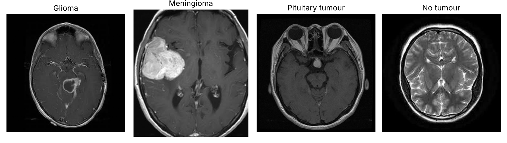
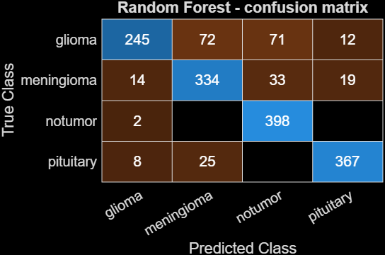

# Brain Tumour MRI Classification (HOG + Random Forest)

Classical machine-learning baseline that classifies brain MRI slices into four classes: **glioma, meningioma, pituitary tumour, no tumour**. Written in MATLAB.

## Pipeline

1. **Preprocessing** (`preprocessMRI.m`): resize to 200×200, grayscale, 3×3 median filter, CLAHE contrast enhancement.
2. **Features** (`computeHOG.m`): Histogram of Oriented Gradients, cell size 6×6, 12 orientation bins (49,152 features per image).
3. **Normalisation**: min-max scaling, fitted on the training set only and reused for the test set.
4. **Classifier** (`train_model.m`): Random Forest (`TreeBagger`, 100 trees).
5. **Evaluation** (`evaluate_model.m`): accuracy, per-class precision / recall / F1, confusion matrix on the held-out test set.
6. **Single-image prediction** (`classify_image.m`).

## Dataset

[Brain Tumor MRI Dataset (Kaggle, Masoud Nickparvar)](https://www.kaggle.com/datasets/masoudnickparvar/brain-tumor-mri-dataset). Images are not included in this repository. Download and unzip so that the folder `brain_mri/` contains `Training/` and `Testing/` (1,400 training and 400 test images per class in the version used).

## Example images



*One axial test-set slice per class (glioma, meningioma, pituitary tumour, no tumour), taken from the Kaggle dataset above. Scan sequence, zoom and slice level vary between images. They illustrate the four classes the model is trained to separate; they are not model predictions.*

## How to run

```matlab
train_model      % trains and saves RandomForestModel.mat
evaluate_model   % prints metrics and saves RandomForest_confusion.png
classify_image('brain_mri/Testing/glioma/<image>.jpg')
```

Requires MATLAB with the Image Processing Toolbox and the Statistics and Machine Learning Toolbox. Change `datasetPath` at the top of the scripts if your folder has a different name.

## Results

Test set: 1,600 images (400 per class). Model: Random Forest (100 trees) on HOG features, trained with `train_model.m` and evaluated with `evaluate_model.m`.

**Overall accuracy: 84.0%** (1,344 of 1,600 correct)

| Class | Precision | Recall | F1 |
|---|---|---|---|
| Glioma | 0.911 | 0.613 | 0.732 |
| Meningioma | 0.775 | 0.835 | 0.804 |
| No tumour | 0.793 | 0.995 | 0.882 |
| Pituitary | 0.922 | 0.918 | 0.920 |



Glioma is the hardest class: only 245 of 400 test gliomas are recognised, and most of the rest are labelled meningioma (72) or no tumour (71). Pituitary and no-tumour slices are classified most reliably.

## Limitations

- Classical hand-crafted-feature baseline; deep-learning approaches are expected to perform better.
- Glioma recall is low (0.61), so many gliomas are missed; the model should not be used for any clinical purpose.
- Single train/test split, no cross-validation.
- Research and learning project only, not a medical device.
